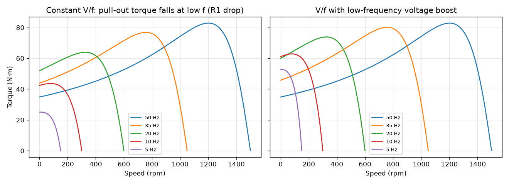

# 1 · Electric motors and drives

Follows Hughes & Drury, *Electric Motors and Drives* (5th ed.), chapters 3 (DC motors),
5–7 (induction motors) and 8 (inverter-fed induction motor drives). Full output:
[results.txt](results.txt).

## 1a DC motor

Separately excited DC motor, 220 V, Ra = 0.5 Ω, k = 1.4 N·m/A.
Equations: V = E + I·Ra, E = k·ω, T = k·I, so ω = (V − T·Ra/k)/k: a straight line with
slope −Ra/k².

| Quantity | Value |
| --- | --- |
| No-load speed V/k | 1501 rpm |
| Rated point (30 A) | 42 N·m at 1398 rpm, 6.8 % speed drop |
| Stall torque k·V/Ra | 616 N·m, 15× rated, so the drive must limit current |

Lowering the armature voltage shifts the line down in parallel: speed control without
losing torque capability ([plot](1a_dc_torque_speed.png)).

## 1b Induction motor

4-pole, 400 V star, 50 Hz, about 5.5 kW, per-phase circuit R1 0.9, X1 2.4, R2′ 0.95,
X2′ 2.4, Xm 50 Ω. Torque from the Thévenin form of the equivalent circuit:
T = 3·I2′²·(R2′/s)/ωs.

| Quantity | Value |
| --- | --- |
| Synchronous speed 120 f/p | 1500 rpm |
| Rated point (5.5 kW) | slip 4.2 %, 1438 rpm, 36.4 N·m |
| Pull-out torque | 82.9 N·m at s = 0.199 (2.3× rated); check s_max = R2′/\|Zth + jX2′\| = 0.199 |
| Starting torque | 34.9 N·m (1.0× rated) |
| Starting current | 45 A per phase, about 4× rated, which is why star–delta or soft starters are used |

A single-cage circuit understates starting torque; real motors use deep-bar or double-cage
rotors to raise it (Hughes ch. 6). [Plot](1b_induction_torque_speed.png).

## 1c Inverter drive, V/f control

Keeping V/f constant keeps the air-gap flux, so the torque curve keeps its shape and moves
with the synchronous speed. At low frequency the stator resistance takes a larger share of
the voltage, flux falls and pull-out torque drops: 82.9 N·m at 50 Hz but 25.1 N·m at 5 Hz.
A low-frequency voltage boost (5 % of rated at 0 Hz) restores it to 52.7 N·m at 5 Hz.

## 1d Sizing the conveyor drive of PLC Task 3

The PCB heat-test conveyor (output M1 in the PLC exercise). The sheet gives no mechanical
data, so these are stated assumptions: 60 kg moving mass, friction coefficient 0.3,
belt 0.25 m/s, drum diameter 0.10 m, 0.5 s ramp, gearbox efficiency 0.9.

| Step | Result |
| --- | --- |
| Friction force μmg | 176.6 N |
| Acceleration force mv/t | 30.0 N |
| Drum torque F·d/2 | 10.33 N·m at 48 rpm |
| Gear ratio (motor about 1425 rpm) | 29.8 : 1 |
| Motor torque | 0.385 N·m |
| Steady shaft power | 49 W, so a 0.12 kW 4-pole motor with a 30:1 gearbox |

A direct-on-line contactor, as in the PLC exercise, is enough for start/stop. A small
inverter would add soft ramps, which protect the boards on the belt, and slower approach to
sensor B2 for positioning.
