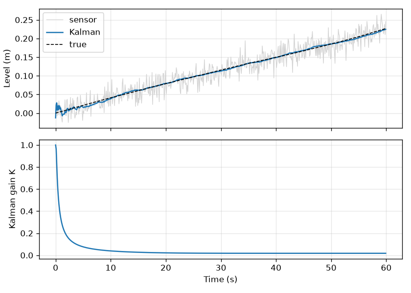

# 2 · Sensors, calibration, filtering and estimation

The pressure transmitter from the PLC course (0–10 bar → 0–10 V on an S7 analog input,
0–27648 counts), simulated with realistic errors: +3 % span error, 0.15 V offset, slight
quadratic non-linearity and 0.04 V rms noise. Fixed random seed, so the numbers repeat.
Full output: [results.txt](results.txt).

## 2a Accuracy vs. precision

| True (bar) | Mean reading (bar) | Bias (bar) | Std (bar) |
| --- | --- | --- | --- |
| 0.0 | 0.145 | +0.145 | 0.035 |
| 5.0 | 5.392 | +0.392 | 0.037 |
| 10.0 | 10.453 | +0.453 | 0.037 |

The bias is the accuracy error: systematic, up to 0.45 bar, removed by calibration. The
spread is the precision: random, 0.04 bar, set by noise, reduced only by filtering. The
ADC resolution (0.36 mbar per count) is far below both.

## 2b Calibration

Against a reference gauge at 11 points, validated on 10 different points:

| Method | Max error |
| --- | --- |
| Uncalibrated | 0.454 bar |
| Two-point (zero and span) | 0.094 bar |
| Least squares over 11 points | 0.048 bar |

Two-point calibration is exact at the ends but leaves the bow of the non-linearity in
mid-range; least squares spreads that residual and halves the worst case. In the PLC it is
one line after scaling: `p_cal := a * p_raw + b;`. [Plot](2b_calibration.png).

## 2c Filtering and stability

A 2 → 6 bar step, sampled every 10 ms:

| Filter | Noise std | 2 % settling |
| --- | --- | --- |
| Raw | 0.040 bar | never (noise is wider than the band) |
| Moving average, N = 20 | 0.010 bar | 0.19 s |
| Exponential y += a(x − y), a = 0.1 | 0.011 bar | 0.34 s |

The moving average is an FIR filter: always stable, delay N·dt. The exponential filter has
one pole at z = 1 − a; it is stable for 0 < a < 2. The script shows a = 1.9 still converges
and a = 2.1 diverges to −1.9 × 10⁸. [Plot](2c_filters.png).

## 2d Kalman filter

Tank level with a constant-rate model (state: level and fill rate), 2 cm sensor noise:

- RMS error falls from 2.00 cm (raw) to 0.20 cm.
- The gain starts at 1.0 (trust the sensor while the model is unknown), is 0.32 after
  10 steps and settles at 0.018. With an observable model and Q > 0 the steady-state
  filter is stable.
- It also estimates the fill rate (3.9 mm/s against a true 4.3 mm/s), which a plain filter
  cannot.

## 2e Data fusion

Two level sensors with 2 cm and 5 cm noise. Inverse-variance weights are 0.862 and 0.138.

| Estimate | Std |
| --- | --- |
| Sensor 1 alone | 1.98 cm |
| Plain average | 2.71 cm |
| Weighted fusion | 1.85 cm (theory 1.86 cm) |

Weighted fusion beats the best single sensor; a plain average does not. This is the static
case of the Kalman update in 2d.
