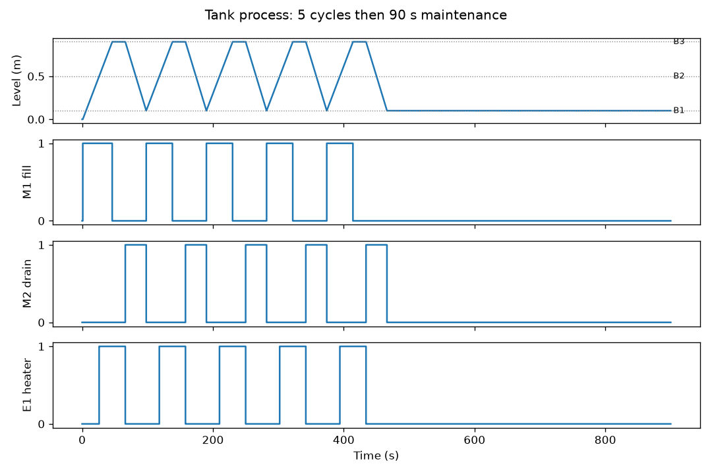

# 3 · From specification to automation design: state machine and automation pyramid

The tank-heating process of PLC exercise Task 2 (Siemens Professional Education assignment):

1. Level below B1 and Start pressed: pump motor M1 fills until the level reaches B3.
2. From B2 on, heater E1 is on while the tank fills.
3. At B3 the heater stays on for 20 s, then turns off.
4. Pump motor M2 then empties the tank until the level drops below B1.
5. The cycle repeats 5 times, then the system stays idle 90 s for maintenance.

## State machine

| State | Outputs | Leaves when | Goes to |
| --- | --- | --- | --- |
| IDLE | none | Start and level below B1 | FILL |
| FILL | M1; E1 once B2 is reached | B3 reached | HEAT_HOLD |
| HEAT_HOLD | E1 | 20 s timer done | DRAIN |
| DRAIN | M2 | level below B1 | FILL (cycles 1–4) or MAINTENANCE (after cycle 5) |
| MAINTENANCE | none | 90 s timer done | IDLE |

Outputs depend on the state (a Moore machine), with B2 as an extra condition on the heater
during FILL. M1 and M2 can never be on together because they belong to different states.

- [tank_fsm.py](tank_fsm.py): the controller written the way a PLC runs it (10 ms scan,
  read inputs, evaluate, write outputs, IEC TON timers), closed-loop with a tank model. It
  checks every spec point against the run.
- [tank.st](tank.st): the same machine in IEC 61131-3 Structured Text as a TIA Portal
  function block. It has not been downloaded to hardware; the Python file is the tested model.

## Result

All five checks pass ([results.txt](results.txt)): M1 stops at B3; the heater is never on
below B2; each hold lasts 20.00 s; M1 and M2 are never on together; exactly 5 cycles, then
90 s of maintenance, then IDLE.

## Place in the automation pyramid

| Level | What it is for this tank | Devices | Data and time scale |
| --- | --- | --- | --- |
| 4 Enterprise (ERP) | Orders, batch planning, material stock | SAP or similar | Batches per day |
| 3 Plant management (MES) | Batch records, the 5-cycle recipe, maintenance scheduling, energy per batch | MES server | Minutes to hours |
| 2 Supervisory (SCADA/HMI) | Operator panel: level, state, cycle count; set heat and maintenance times; alarms | HMI panel or SCADA PC | Seconds; Modbus TCP or PROFINET to level 1 (exercise 4) |
| 1 Control | The state machine above | S7-1200/1500 PLC | 10 ms scan |
| 0 Field | Level sensors B1–B3, Start button, pump motors M1/M2 with contactors, heater E1 | 24 V DC digital I/O, contactors | Milliseconds |

Each level reduces the data and slows the time scale: the field level switches outputs in
milliseconds; the MES sees one batch record per cycle. Exercise 4 implements the link
between levels 1 and 2.
